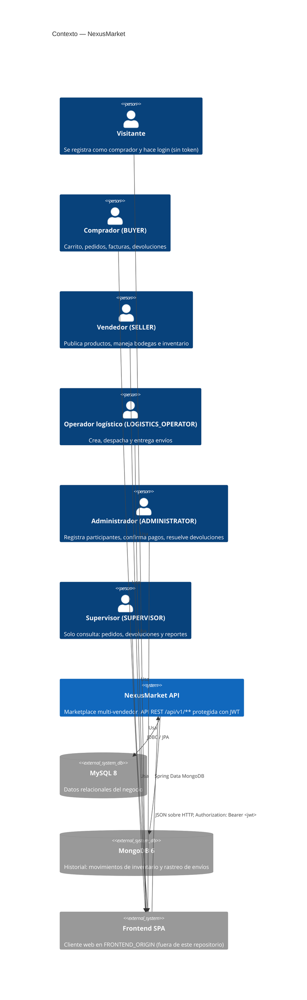

# C4 Nivel 1 — Contexto

## Propósito

Mostrar NexusMarket como una caja negra: quién lo usa y con qué sistemas
externos se comunica.

## Diagrama

## Actores y lo que pueden hacer

| Actor | Prefijo de rutas | Puerto de entrada | Ejemplos |
|---|---|---|---|
| Visitante | `/api/v1/public`, `/api/v1/auth` | `PublicAccessPort` | Registrarse y hacer login (las únicas peticiones sin token); con token, buscar en el catálogo |
| Comprador | `/api/v1/buyer` | `BuyerPort` | Carrito, checkout, factura, devolución |
| Vendedor | `/api/v1/seller` | `SellerPort` | Publicar producto, inventario, reporte de desempeño |
| Operador logístico | `/api/v1/operator` | `LogisticsOperatorPort` | Crear, despachar y entregar envíos |
| Administrador | `/api/v1/admin` | `AdministratorPort` | Usuarios, pagos, facturas, devoluciones, reembolsos |
| Supervisor | `/api/v1/supervisor` | `SupervisorPort` | Consultas y reportes, sin modificar nada |

## Sistemas externos

| Sistema | Para qué |
|---|---|
| MySQL | Personas, usuarios, productos, bodegas, inventario, carritos, pedidos, devoluciones |
| MongoDB | `inventory_movements` y `shipment_tracking` (historiales que solo crecen) |
| Frontend SPA | Único origen permitido por CORS (`FRONTEND_ORIGIN`, por defecto `http://localhost:5173`) |
