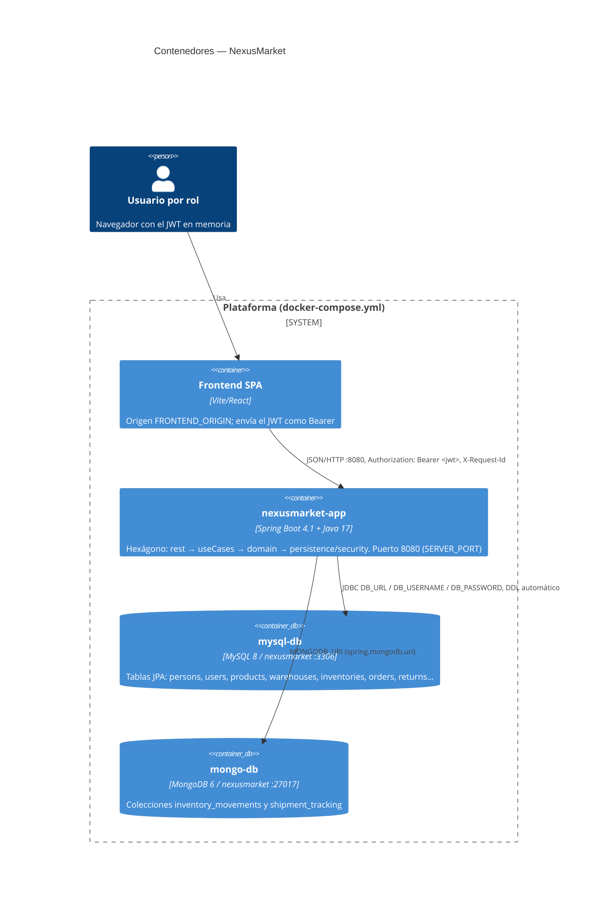
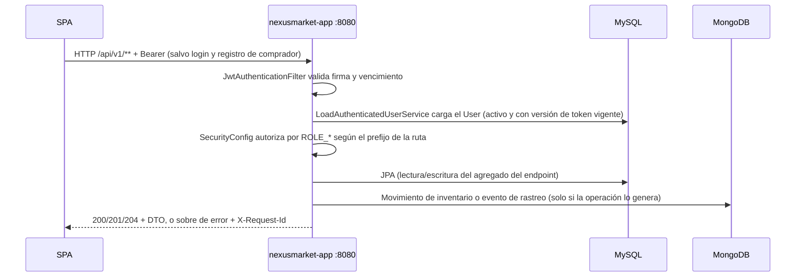

# C4 Nivel 2 — Contenedores

## Propósito

Mostrar dónde se ejecuta cada parte y cómo viaja una petición desde el
navegador hasta las bases de datos.

## Diagrama

## Contenedores y configuración

| Contenedor | Imagen / arranque | Variables relevantes | Papel |
|---|---|---|---|
| `spa` | Fuera de este repositorio (`:5173`) | `FRONTEND_ORIGIN` del lado de la app | Dispara todos los flujos; el preflight `OPTIONS` va sin JWT |
| `nexusmarket-app` | `nexusmarket/nexusmarketII/Dockerfile` (Maven + JDK 17) | `DB_URL`, `DB_USERNAME`, `DB_PASSWORD`, `MONGODB_URI`, `JWT_SECRET`, `JWT_EXPIRATION_MS`, `FRONTEND_ORIGIN`, `SPRING_PROFILES_ACTIVE`, `SERVER_PORT` | Atiende `/api/v1/**`, valida el JWT, ejecuta el dominio y persiste |
| `mysql-db` | `mysql:8.0` con `healthcheck` | `MYSQL_DATABASE=nexusmarket`, `MYSQL_USER=nexusmarket_app` | Lecturas y escrituras de todos los agregados |
| `mongo-db` | `mongo:6.0` con `healthcheck` | — | Escritura de movimientos de inventario y eventos de rastreo; lectura del historial |

`nexusmarket-app` espera a que `mysql-db` y `mongo-db` estén sanos (`depends_on: condition: service_healthy`).
Se levanta todo con `docker compose up --build` desde la raíz del repositorio (ver `SETUP.md`, opción C).

Sin Docker, el perfil `memory` reemplaza ambos contenedores de datos por adaptadores en memoria
dentro del mismo proceso.

## Flujo de red de una petición

Semántica: `200/201/204` éxito · `400` validación · `401` sin token, token inválido o credenciales
incorrectas · `403` rol o propiedad · `404` no encontrado · `409` duplicado o transición inválida ·
`422` regla de negocio.
