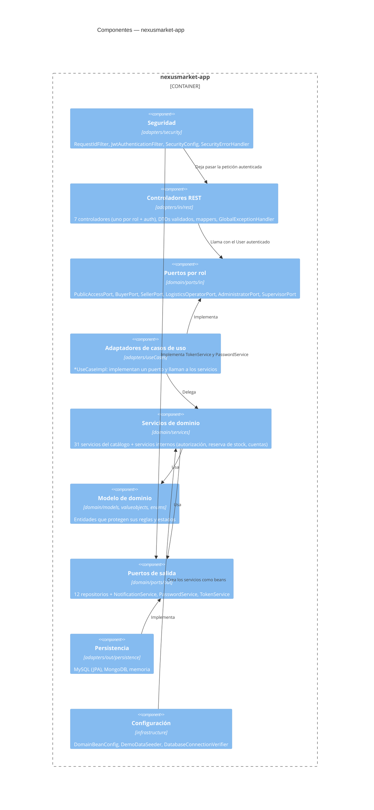

# C4 Nivel 3 — Componentes

## Propósito

Abrir el contenedor `nexusmarket-app` y mostrar sus componentes y el orden
en que participan en una petición.

## Diagrama

## Ciclo de vida de una petición

1. `RequestIdFilter` asigna o reutiliza `X-Request-Id`.
2. `JwtAuthenticationFilter` valida el token con `TokenService` y pide el `User` a
   `LoadAuthenticatedUserService` (dominio). Si no hay usuario válido, la petición sigue sin autenticar.
3. `SecurityConfig` exige el rol del prefijo de la ruta; si falla, `SecurityErrorHandler` responde `401`/`403`.
4. El controlador valida el DTO (`@Valid`), lo convierte con su mapper y llama al puerto de su rol.
5. El `*UseCaseImpl` pasa `user.getIdentifier()` como solicitante y llama al servicio de dominio.
6. El servicio revisa permisos (`ValidatePermissionsService`) y propiedad (`ValidateOwnershipAccessService`),
   aplica las reglas sobre el modelo y guarda por los puertos de salida.
7. El controlador convierte el resultado en DTO de respuesta. Si hubo una excepción,
   `GlobalExceptionHandler` la traduce al sobre de error y deja un `WARN` con el `requestId`.
