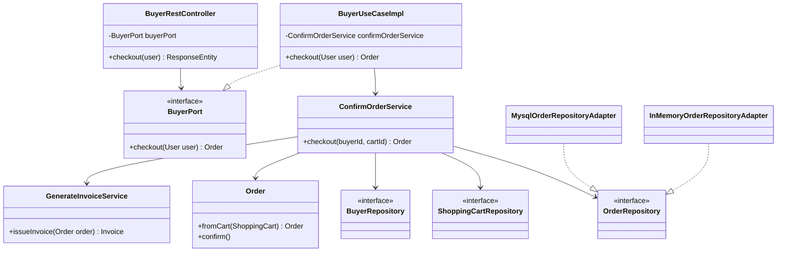

# C4 Nivel 4 — Código

## Propósito

Mostrar las clases reales que colaboran en el flujo central del negocio:
el comprador confirma su carrito (`POST /api/v1/buyer/orders`).

## Diagrama de clases (flujo de checkout)

## Clases clave por capa

| Capa | Clase | Responsabilidad en el flujo |
|---|---|---|
| REST | `BuyerRestController` | Recibe la petición; el comprador sale del token, nunca del cuerpo |
| Puerto de entrada | `BuyerPort` | Contrato de todo lo que puede hacer un comprador |
| Caso de uso | `BuyerUseCaseImpl` | Llama a `ConfirmOrderService.checkout(user.getIdentifier(), null)` |
| Dominio | `ConfirmOrderService` | Comprador activo y habilitado, carrito propio y no vacío; crea el pedido |
| Dominio | `GenerateInvoiceService` | Factura con IVA incluido (`neto = total / 1,19`) |
| Dominio | `Order` | `fromCart` y `confirm()` pasan el pedido a `PENDING_PAYMENT` |
| Puerto de salida | `OrderRepository` | El dominio pide guardar sin saber dónde |
| Persistencia | `MysqlOrderRepositoryAdapter` / `InMemoryOrderRepositoryAdapter` | Uno u otro según el perfil activo |

Todos los servicios siguen el mismo patrón: una clase por servicio del catálogo, dependencias por
constructor y ninguna anotación de Spring (los registra `DomainBeanConfig`).
