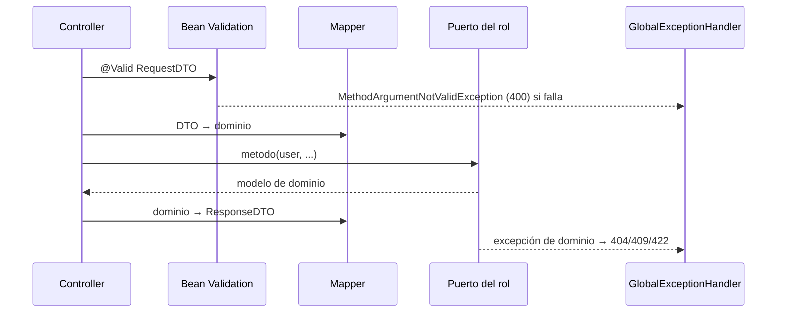

# Capa — Adaptador de entrada REST

Paquete: `adapters/in/rest/`.

## Contenido

| Carpeta | Clases | Papel |
|---|---|---|
| `controllers/` | `AuthRestController`, `PublicAccessRestController`, `BuyerRestController`, `SellerRestController`, `LogisticsOperatorRestController`, `AdministratorRestController`, `SupervisorRestController` | Un controlador por rol; cada uno depende solo de su puerto |
| `requests/` | 21 records (`LoginRequest`, `AddCartItemRequest`, `InventoryMovementRequest`, ...) | Entrada validada con Bean Validation |
| `responses/` | DTOs de salida, `ApiResponse` (sobre de éxito) y `ErrorResponse` | Nunca se expone una entidad del dominio ni una contraseña |
| `mappers/` | `*DtoMapper` (10, por ejemplo `OrderDtoMapper`, `CartDtoMapper`) y `FilterParamMapper` | DTO ↔ dominio y filtros de listados |
| `exception/` | `GlobalExceptionHandler` | Un solo sobre de error para toda la API |

## Reglas

1. El solicitante siempre es el `User` autenticado (`@AuthenticationPrincipal`); los cuerpos nunca traen "quién soy".
2. Los códigos de catálogo (`status`, `role`, `movementType`) se validan con `@Pattern` contra el catálogo exacto.
3. Cantidades y montos tienen rango (`@Max`, `@Min`, `@Digits`), identificadores máximo 64 caracteres.
4. Cada error `4xx` queda en el log como `WARN` con `requestId`, método, ruta, estado y código.

## Flujo

Ver también `Adapters/Rest-adapters.md`, `Rest-validation.md` y `Global-exception-handler.md`.
