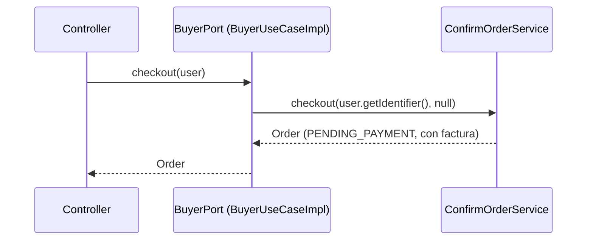

# Capa — Adaptadores de casos de uso

Paquete: `adapters/useCases/`.

## Contenido

| Puerto (`domain/ports/in`) | Implementación | Servicios que inyecta |
|---|---|---|
| `PublicAccessPort` | `PublicAccessUseCaseImpl` | `RegisterBuyerService`, `ManageProductService`, `AuthenticateUserService` |
| `BuyerPort` | `BuyerUseCaseImpl` | `ManageBuyerService`, `ManageProductService`, `ManageCartItemsService`, `ConsultCartService`, `ConfirmOrderService`, `ConsultOrderService`, `ConsultInvoiceService`, `ConsultShipmentService`, `RequestReturnService`, `ResolveReturnService`, `ProcessRefundService` |
| `SellerPort` | `SellerUseCaseImpl` | `ManageSellerService`, `RegisterWarehouseService`, `ManageWarehouseService`, `PublishProductService`, `ManageProductService`, `ChangeProductStatusService`, `RegisterInventoryMovementService`, `ConsultInventoryService`, `ConsultOrderService`, `ConsultInvoiceService`, `ConsultShipmentService`, `ResolveReturnService`, `ConsultSellerPerformanceReportService` |
| `LogisticsOperatorPort` | `LogisticsOperatorUseCaseImpl` | `ManageUserService`, `ManageWarehouseService`, `ManageProductService`, `RegisterInventoryMovementService`, `ConsultInventoryService`, `CreateShipmentService`, `UpdateShipmentStatusService`, `ConsultShipmentService`, `ConsultOrderService`, `UpdateOrderStatusService` |
| `AdministratorPort` | `AdministratorUseCaseImpl` | 23 servicios (registro y gestión de participantes, inventario, pagos, facturas, envíos, devoluciones, reembolsos, reportes) |
| `SupervisorPort` | `SupervisorUseCaseImpl` | Solo operaciones de consulta de 13 servicios |

## Reglas

1. Cada clase implementa exactamente un puerto por rol.
2. Inyecta directamente las clases de servicio del dominio: **no hay interfaces por operación**.
3. Pasa `user.getIdentifier()` como solicitante y fija lo que el rol implica
   (el comprador del checkout, el dueño de la bodega del vendedor, el operador asignado al envío).
4. No contiene reglas de negocio.

## Flujo

Ver `Adapters/Use-cases-adapters.md`.
