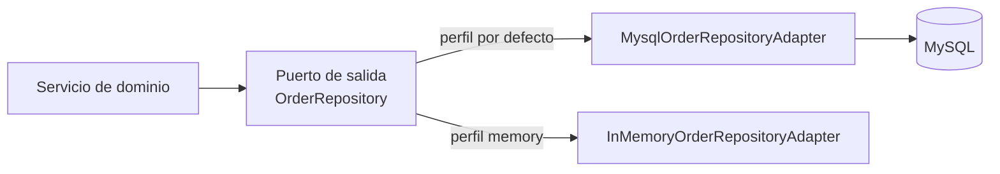

# Capa — Adaptadores de persistencia

Paquete: `adapters/out/persistence/` (más `adapters/out/notification/`).

## 1. MySQL (perfil por defecto)

| Carpeta | Clases |
|---|---|
| `mysql/adapters/` | `MysqlPersonRepositoryAdapter`, `MysqlUserRepositoryAdapter`, `MysqlBuyerRepositoryAdapter`, `MysqlSellerRepositoryAdapter`, `MysqlWarehouseRepositoryAdapter`, `MysqlProductRepositoryAdapter`, `MysqlInventoryRepositoryAdapter`, `MysqlShoppingCartRepositoryAdapter`, `MysqlOrderRepositoryAdapter`, `MysqlReturnRepositoryAdapter` |
| `mysql/entities/` | Entidades JPA: `persons`, `users`, `buyers`, `sellers`, `warehouses` (+ `seller_warehouses`, `marketplace_warehouses`), `products` (+ `physical_products`, `digital_products`, `product_variants`), `inventories`, `shopping_carts`, `cart_items`, `orders`, `order_items`, `returns` |
| `mysql/repositories/` | Interfaces Spring Data JPA (`*JpaRepository`) |
| `mysql/mappers/` | Entidad ↔ dominio (`PersonMapper`, `OrderMapper`, ...) |

## 2. MongoDB (perfil por defecto)

| Colección | Adaptador | Puerto |
|---|---|---|
| `inventory_movements` | `MongoInventoryMovementRepositoryAdapter` | `InventoryMovementRepository` |
| `shipment_tracking` | `MongoShipmentTrackingRepositoryAdapter` | `ShipmentTrackingRepository` |

Son historiales que solo crecen y se consultan por fecha; por eso van en un modelo de documentos.

## 3. Memoria (perfil `memory`)

`InMemory*RepositoryAdapter` sobre `InMemoryDataStore`: implementan los mismos 12 puertos sin bases
de datos. Lo usan las pruebas de integración y la ejecución local sin Docker.

## 4. Selección por perfil

## 5. Notificaciones

`LoggingNotificationAdapter` implementa `NotificationService` dejando el aviso en el log
(no hay correo real en este proyecto).

Ver `Adapters/Persistence-adapters.md`.
