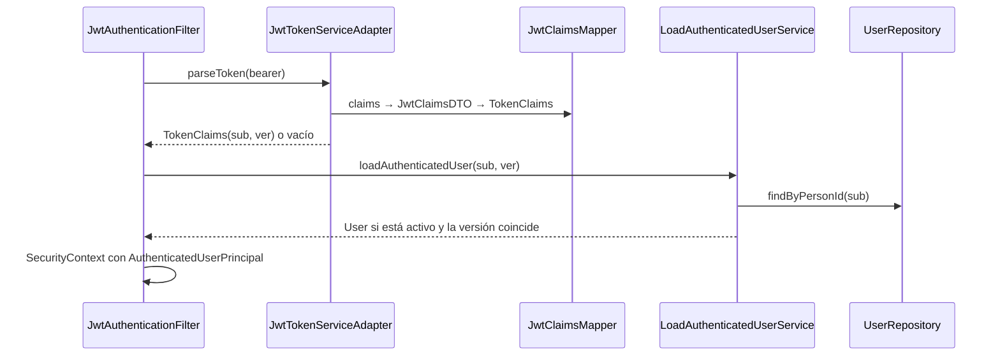

# Capa — Adaptador de seguridad

Paquete: `adapters/security/`.

## Contenido

| Clase | Papel |
|---|---|
| `SecurityConfig` | `SecurityFilterChain` sin sesión, sin CSRF ni HTTP Basic; un rol por prefijo de ruta; CORS; `PasswordEncoder` BCrypt |
| `JwtAuthenticationFilter` | Lee `Authorization: Bearer`, valida el token y pide el `User` a `LoadAuthenticatedUserService` |
| `JwtTokenServiceAdapter` | Implementa `TokenService`: firma HS256 y valida tokens con JJWT |
| `dtos/JwtClaimsDTO` | Claims del token: `sub`, `jti`, `ver`, `iat`, `exp` |
| `mappers/JwtClaimsMapper` | `User` → `JwtClaimsDTO` → claims y claims → `TokenService.TokenClaims` |
| `dtos/AuthenticatedUserPrincipal` | Principal con el `User` del dominio y su autoridad `ROLE_*` |
| `BCryptPasswordServiceAdapter` | Implementa `PasswordService` (`hash`, `matches`) |
| `SecurityErrorHandler` | Respuestas `401`/`403` con el mismo sobre de error de la API |
| `RequestIdFilter` | Correlación `X-Request-Id` (también en el MDC del log) |

## Rutas sin token

Toda petición exige un token válido salvo dos: `POST /api/v1/auth/login`, que es la que entrega el token, y `POST /api/v1/public/buyers`, el registro de comprador que crea la cuenta. El catálogo y el health también piden token. `OPTIONS` (CORS) y `/error` quedan abiertos solo por razones técnicas y no devuelven datos.

## Decisión: token mínimo

El token **solo lleva identidad** (persona y versión). El rol y el estado se leen del `User` vigente
en cada petición, a través del servicio de dominio `LoadAuthenticatedUserService`. Así:

- un bloqueo o un cambio de rol aplica en la siguiente petición, sin esperar a un nuevo login;
- logout y cambio de contraseña incrementan `authTokenVersion` y todos los tokens anteriores dejan de servir;
- el token no expone datos personales.

## Flujo de autenticación

## Login

`AuthRestController` → `PublicAccessPort.login` → `AuthenticateUserService.login`: valida la
contraseña con `PasswordService`, rechaza cuentas inactivas y emite el token con `TokenService`.

Ver `Adapters/Rest-security-cors.md`.
