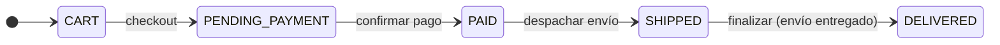

# Capa — Dominio

Paquete: `domain/`. No importa Spring, JPA, MongoDB, HTTP ni JSON.

## Contenido

| Carpeta | Contenido |
|---|---|
| `models/` | 29 clases: personas (`Buyer`, `Seller`, `Administrator`, `Supervisor`, `LogisticsOperator`), `User`, productos, bodegas, `Inventory`, carrito, `Order`, `Invoice`, `Shipment`, `Return`, `Refund`, reportes |
| `valueobjects/` | `Address`, `OrderStatus`, `ProductStatus`, `SystemRole`, `UserStatus`, `BuyerCommercialStatus`, `InventoryMovementType`, `DomainCatalog` |
| `enums/` | `BusinessOperation` (matriz de permisos), `ShipmentStatus`, `ReturnStatus`, `RefundStatus`, `TrackingEventType` |
| `services/` | 31 servicios del catálogo en 14 subpaquetes + servicios internos |
| `ports/in/` | 6 puertos por rol |
| `ports/out/` | 12 repositorios + `NotificationService`, `PasswordService`, `TokenService` |
| `exceptions/` | 14 excepciones hijas de `DomainException` |

## Servicios

Una clase por servicio del catálogo (por ejemplo `order/ConfirmOrderService` para "Confirm Order").
Servicios internos que no expone ningún puerto:

| Servicio | Uso |
|---|---|
| `ValidatePermissionsService` | Revisa la matriz `BusinessOperation` |
| `ValidateOwnershipAccessService` | Revisa que el dato sea del solicitante |
| `InventoryReservationService` | Reserva, libera, confirma venta y reingresa stock entre bodegas |
| `UserAccountService` | Crea la cuenta con contraseña validada y cifrada |
| `LoadAuthenticatedUserService` | Resuelve el `User` autenticado a partir del token |

## Ciclos de vida

Envío: `PENDING → IN_TRANSIT → DELIVERED`, o `IN_TRANSIT → RETURNED → IN_TRANSIT` si la entrega falla.
Devolución: `REQUESTED → APPROVED → COMPLETED`, o `REQUESTED → REJECTED`.
Reembolso: `PENDING → PROCESSED` o `REJECTED`.

Ver `domain/Domain Model.md`, `domain/Services.md` y `domain/services/*.md`.
