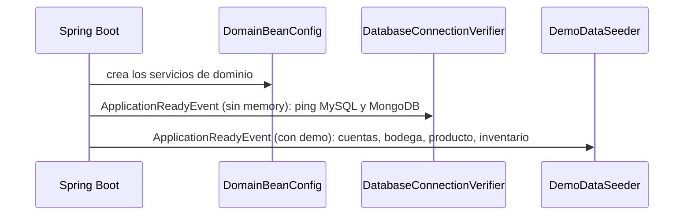

# Capa — Infraestructura

Paquete: `infrastructure/`. Configuración técnica; no contiene reglas de negocio.

## Contenido

| Carpeta | Clase | Papel |
|---|---|---|
| `config/` | `DomainBeanConfig` | Declara cada servicio de dominio como `@Bean` e inyecta sus puertos de salida. Los servicios no llevan anotaciones de Spring. La tasa de IVA llega por `nexusmarket.billing.tax-rate` |
| `seed/` | `DemoDataSeeder` | Con el perfil `demo`, crea una cuenta por rol (`administrator-1`, `supervisor-1`, `seller-1`, `buyer-1`, `operator-1`), la bodega `warehouse-1`, el producto `product-1` y su inventario. Idempotente por identificador |
| `database/` | `DatabaseConnectionVerifier` | Al arrancar (sin perfil `memory`) revisa y registra la conexión con MySQL y MongoDB |

## Perfiles

| Perfil | Efecto |
|---|---|
| *(por defecto)* | Adaptadores MySQL y MongoDB |
| `memory` | Adaptadores en memoria; se desactiva la autoconfiguración de MySQL y MongoDB |
| `demo` | Carga los datos de demostración; se combina con cualquiera de los anteriores |

## Arranque

