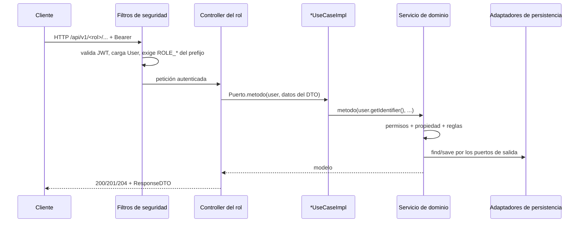
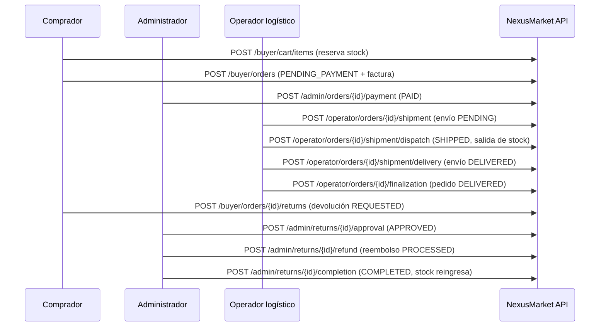

# Flujos por endpoint

Matriz generada a partir de `adapters/in/rest/controllers/*.java` y de las tablas de
`domain/Input-ports.md`: para cada uno de los **138 endpoints**, el método del puerto que llama
el controlador y el servicio de dominio que ejecuta la regla. Los diagramas muestran el camino
feliz de cada grupo; los errores están al final.

## Secuencia común

## Flujo de compra completo

## Matriz por controlador

### Administrator

| Método | Ruta | `AdministratorPort` | Servicio de dominio |
|---|---|---|---|
| `POST` | `/api/v1/admin/users` | `registerUser` | `RegisterUserService` |
| `GET` | `/api/v1/admin/users/{userId}` | `consultUser` | `ManageUserService` |
| `PUT` | `/api/v1/admin/users/{userId}` | `updateUser` | `ManageUserService` |
| `PATCH` | `/api/v1/admin/users/{userId}/status` | `changeUserStatus` | `ManageUserService` |
| `POST` | `/api/v1/admin/sellers` | `registerSeller` | `RegisterSellerService` |
| `GET` | `/api/v1/admin/sellers/{sellerId}` | `consultSeller` | `ManageSellerService` |
| `PUT` | `/api/v1/admin/sellers/{sellerId}` | `updateSeller` | `ManageSellerService` |
| `PATCH` | `/api/v1/admin/sellers/{sellerId}/status` | `changeSellerStatus` | `ManageSellerService` |
| `GET` | `/api/v1/admin/sellers/{sellerId}/performance-report` | `consultSellerPerformanceReport` | `ConsultSellerPerformanceReportService` |
| `POST` | `/api/v1/admin/buyers` | `registerBuyer` | `RegisterBuyerService` |
| `GET` | `/api/v1/admin/buyers/{buyerId}` | `consultBuyer` | `ManageBuyerService` |
| `PUT` | `/api/v1/admin/buyers/{buyerId}` | `updateBuyer` | `ManageBuyerService` |
| `PATCH` | `/api/v1/admin/buyers/{buyerId}/commercial-status` | `changeBuyerCommercialStatus` | `ManageBuyerService` |
| `GET` | `/api/v1/admin/buyers/{buyerId}/orders` | `consultBuyerOrders` | `ManageBuyerService` |
| `GET` | `/api/v1/admin/buyers/{buyerId}/returns` | `consultBuyerReturns` | `ManageBuyerService` |
| `GET` | `/api/v1/admin/buyers/{buyerId}/refunds` | `consultBuyerRefunds` | `ManageBuyerService` |
| `POST` | `/api/v1/admin/warehouses` | `registerWarehouse` | `RegisterWarehouseService` |
| `GET` | `/api/v1/admin/warehouses/{warehouseId}` | `consultWarehouse` | `ManageWarehouseService` |
| `PUT` | `/api/v1/admin/warehouses/{warehouseId}` | `updateWarehouse` | `ManageWarehouseService` |
| `GET` | `/api/v1/admin/products/{productId}` | `consultProduct` | `ManageProductService` |
| `PATCH` | `/api/v1/admin/products/{productId}/status` | `changeProductStatus` | `ChangeProductStatusService` |
| `POST` | `/api/v1/admin/inventory/movements` | `registerInventoryMovement` | `RegisterInventoryMovementService` |
| `POST` | `/api/v1/admin/inventory/damaged` | `registerDamagedStock` | `RegisterInventoryMovementService` |
| `GET` | `/api/v1/admin/inventory` | `consultInventory` | `ConsultInventoryService` |
| `GET` | `/api/v1/admin/orders/{orderId}` | `consultOrder` | `ConsultOrderService` |
| `POST` | `/api/v1/admin/orders/{orderId}/payment` | `confirmOrderPayment` | `UpdateOrderStatusService` |
| `POST` | `/api/v1/admin/orders/{orderId}/finalization` | `finalizeOrder` | `UpdateOrderStatusService` |
| `POST` | `/api/v1/admin/orders/{orderId}/invoice` | `generateInvoice` | `GenerateInvoiceService` |
| `GET` | `/api/v1/admin/orders/{orderId}/invoice` | `consultInvoice` | `ConsultInvoiceService` |
| `POST` | `/api/v1/admin/orders/{orderId}/shipment` | `createShipment` | `CreateShipmentService` |
| `POST` | `/api/v1/admin/orders/{orderId}/shipment/dispatch` | `dispatchShipment` | `UpdateShipmentStatusService` |
| `POST` | `/api/v1/admin/orders/{orderId}/shipment/delivery` | `confirmDelivery` | `UpdateShipmentStatusService` |
| `GET` | `/api/v1/admin/orders/{orderId}/shipment` | `consultShipment` | `ConsultShipmentService` |
| `GET` | `/api/v1/admin/orders/{orderId}/tracking` | `consultTracking` | `ConsultShipmentService` |
| `POST` | `/api/v1/admin/returns/{returnId}/approval` | `approveReturn` | `ResolveReturnService` |
| `POST` | `/api/v1/admin/returns/{returnId}/rejection` | `rejectReturn` | `ResolveReturnService` |
| `POST` | `/api/v1/admin/returns/{returnId}/completion` | `completeReturn` | `ResolveReturnService` |
| `GET` | `/api/v1/admin/returns/{returnId}` | `consultReturn` | `ResolveReturnService` |
| `POST` | `/api/v1/admin/returns/{returnId}/refund` | `processRefund` | `ProcessRefundService` |
| `GET` | `/api/v1/admin/returns/{returnId}/refund` | `consultRefund` | `ProcessRefundService` |
| `GET` | `/api/v1/admin/reports/commercial` | `consultCommercialReport` | `ConsultCommercialReportService` |
| `GET` | `/api/v1/admin/users` | `listUsers` | `ManageUserService` |
| `GET` | `/api/v1/admin/warehouses` | `listWarehouses` | `ManageWarehouseService` |
| `GET` | `/api/v1/admin/sellers/{sellerId}/products` | `consultSellerProducts` | `ManageProductService` |
| `GET` | `/api/v1/admin/orders` | `listOrders` | `ConsultOrderService` |
| `GET` | `/api/v1/admin/returns` | `listReturns` | `ResolveReturnService` |
| `GET` | `/api/v1/admin/inventory/movements` | `consultInventoryMovements` | `ConsultInventoryService` |
| `POST` | `/api/v1/admin/orders/{orderId}/shipment/return` | `registerShipmentReturn` | `UpdateShipmentStatusService` |
| `POST` | `/api/v1/admin/returns/{returnId}/refund/rejection` | `rejectRefund` | `ProcessRefundService` |

### Auth

| Método | Ruta | `PublicAccessPort` | Servicio de dominio |
|---|---|---|---|
| `POST` | `/api/v1/auth/login` | `login` | `AuthenticateUserService` |
| `POST` | `/api/v1/auth/logout` | `logout` | `AuthenticateUserService` |
| `PUT` | `/api/v1/auth/password` | `changeMyPassword` | `AuthenticateUserService` |

### Buyer

| Método | Ruta | `BuyerPort` | Servicio de dominio |
|---|---|---|---|
| `GET` | `/api/v1/buyer/profile` | `consultMyProfile` | `ManageBuyerService` |
| `PUT` | `/api/v1/buyer/profile` | `updateMyProfile` | `ManageBuyerService` |
| `GET` | `/api/v1/buyer/products/{productId}` | `consultProduct` | `ManageProductService` |
| `GET` | `/api/v1/buyer/cart` | `consultMyCart` | `ConsultCartService` |
| `POST` | `/api/v1/buyer/cart/items` | `addItemToCart` | `ManageCartItemsService` |
| `PUT` | `/api/v1/buyer/cart/items/{productId}` | `updateCartItemQuantity` | `ManageCartItemsService` |
| `DELETE` | `/api/v1/buyer/cart/items/{productId}` | `removeCartItem` | `ManageCartItemsService` |
| `DELETE` | `/api/v1/buyer/cart` | `clearCart` | `ManageCartItemsService` |
| `POST` | `/api/v1/buyer/orders` | `checkout` | `ConfirmOrderService` |
| `GET` | `/api/v1/buyer/orders` | `consultMyOrders` | `ManageBuyerService` |
| `GET` | `/api/v1/buyer/orders/{orderId}` | `consultOrder` | `ConsultOrderService` |
| `GET` | `/api/v1/buyer/orders/{orderId}/invoice` | `consultInvoice` | `ConsultInvoiceService` |
| `GET` | `/api/v1/buyer/orders/{orderId}/shipment` | `consultShipment` | `ConsultShipmentService` |
| `GET` | `/api/v1/buyer/orders/{orderId}/tracking` | `consultTracking` | `ConsultShipmentService` |
| `POST` | `/api/v1/buyer/orders/{orderId}/returns` | `requestReturn` | `RequestReturnService` |
| `GET` | `/api/v1/buyer/returns` | `consultMyReturns` | `ManageBuyerService` |
| `GET` | `/api/v1/buyer/returns/{returnId}` | `consultReturn` | `ResolveReturnService` |
| `GET` | `/api/v1/buyer/returns/{returnId}/refund` | `consultRefund` | `ProcessRefundService` |
| `GET` | `/api/v1/buyer/refunds` | `consultMyRefunds` | `ManageBuyerService` |

### LogisticsOperator

| Método | Ruta | `LogisticsOperatorPort` | Servicio de dominio |
|---|---|---|---|
| `GET` | `/api/v1/operator/profile` | `consultMyProfile` | `ManageUserService` |
| `PUT` | `/api/v1/operator/profile` | `updateMyProfile` | `ManageUserService` |
| `GET` | `/api/v1/operator/warehouses/{warehouseId}` | `consultWarehouse` | `ManageWarehouseService` |
| `GET` | `/api/v1/operator/products/{productId}` | `consultProduct` | `ManageProductService` |
| `POST` | `/api/v1/operator/inventory/movements` | `registerInventoryMovement` | `RegisterInventoryMovementService` |
| `POST` | `/api/v1/operator/inventory/damaged` | `registerDamagedStock` | `RegisterInventoryMovementService` |
| `GET` | `/api/v1/operator/inventory` | `consultInventory` | `ConsultInventoryService` |
| `POST` | `/api/v1/operator/orders/{orderId}/shipment` | `createShipment` | `CreateShipmentService` |
| `POST` | `/api/v1/operator/orders/{orderId}/shipment/dispatch` | `dispatchShipment` | `UpdateShipmentStatusService` |
| `POST` | `/api/v1/operator/orders/{orderId}/shipment/delivery` | `confirmDelivery` | `UpdateShipmentStatusService` |
| `GET` | `/api/v1/operator/orders/{orderId}/shipment` | `consultShipment` | `ConsultShipmentService` |
| `GET` | `/api/v1/operator/orders/{orderId}/tracking` | `consultTracking` | `ConsultShipmentService` |
| `GET` | `/api/v1/operator/orders/{orderId}` | `consultOrder` | `ConsultOrderService` |
| `POST` | `/api/v1/operator/orders/{orderId}/finalization` | `finalizeOrder` | `UpdateOrderStatusService` |
| `GET` | `/api/v1/operator/warehouses` | `listWarehouses` | `ManageWarehouseService` |
| `GET` | `/api/v1/operator/orders` | `consultAssignedOrders` | `ConsultOrderService` |
| `POST` | `/api/v1/operator/orders/{orderId}/shipment/return` | `registerShipmentReturn` | `UpdateShipmentStatusService` |
| `GET` | `/api/v1/operator/inventory/movements` | `consultInventoryMovements` | `ConsultInventoryService` |

### PublicAccess

| Método | Ruta | `PublicAccessPort` | Servicio de dominio |
|---|---|---|---|
| `POST` | `/api/v1/public/buyers` | `registerBuyer` | `RegisterBuyerService` |
| `GET` | `/api/v1/public/products/{productId}` | `consultCatalogProduct` | `ManageProductService` |
| `GET` | `/api/v1/public/products` | `searchCatalog` | `ManageProductService` |

### Seller

| Método | Ruta | `SellerPort` | Servicio de dominio |
|---|---|---|---|
| `GET` | `/api/v1/seller/profile` | `consultMyProfile` | `ManageSellerService` |
| `PUT` | `/api/v1/seller/profile` | `updateMyProfile` | `ManageSellerService` |
| `POST` | `/api/v1/seller/warehouses` | `registerWarehouse` | `RegisterWarehouseService` |
| `GET` | `/api/v1/seller/warehouses/{warehouseId}` | `consultWarehouse` | `ManageWarehouseService` |
| `PUT` | `/api/v1/seller/warehouses/{warehouseId}` | `updateWarehouse` | `ManageWarehouseService` |
| `POST` | `/api/v1/seller/products` | `publishProduct` | `PublishProductService` |
| `GET` | `/api/v1/seller/products/{productId}` | `consultProduct` | `ManageProductService` |
| `PUT` | `/api/v1/seller/products/{productId}` | `updateProduct` | `ManageProductService` |
| `PATCH` | `/api/v1/seller/products/{productId}/status` | `changeProductStatus` | `ChangeProductStatusService` |
| `POST` | `/api/v1/seller/inventory/movements` | `registerInventoryMovement` | `RegisterInventoryMovementService` |
| `POST` | `/api/v1/seller/inventory/damaged` | `registerDamagedStock` | `RegisterInventoryMovementService` |
| `GET` | `/api/v1/seller/inventory` | `consultInventory` | `ConsultInventoryService` |
| `GET` | `/api/v1/seller/orders/{orderId}` | `consultOrder` | `ConsultOrderService` |
| `GET` | `/api/v1/seller/orders/{orderId}/invoice` | `consultInvoice` | `ConsultInvoiceService` |
| `GET` | `/api/v1/seller/orders/{orderId}/shipment` | `consultShipment` | `ConsultShipmentService` |
| `GET` | `/api/v1/seller/orders/{orderId}/tracking` | `consultTracking` | `ConsultShipmentService` |
| `GET` | `/api/v1/seller/returns/{returnId}` | `consultReturn` | `ResolveReturnService` |
| `GET` | `/api/v1/seller/reports/performance` | `consultMyPerformanceReport` | `ConsultSellerPerformanceReportService` |
| `GET` | `/api/v1/seller/products` | `consultMyProducts` | `ManageProductService` |
| `GET` | `/api/v1/seller/warehouses` | `consultMyWarehouses` | `ManageWarehouseService` |
| `GET` | `/api/v1/seller/orders` | `consultMyOrders` | `ConsultOrderService` |
| `GET` | `/api/v1/seller/returns` | `consultMyReturns` | `ResolveReturnService` |
| `GET` | `/api/v1/seller/inventory/movements` | `consultInventoryMovements` | `ConsultInventoryService` |

### Supervisor

| Método | Ruta | `SupervisorPort` | Servicio de dominio |
|---|---|---|---|
| `GET` | `/api/v1/supervisor/users/{userId}` | `consultUser` | `ManageUserService` |
| `GET` | `/api/v1/supervisor/sellers/{sellerId}` | `consultSeller` | `ManageSellerService` |
| `GET` | `/api/v1/supervisor/sellers/{sellerId}/performance-report` | `consultSellerPerformanceReport` | `ConsultSellerPerformanceReportService` |
| `GET` | `/api/v1/supervisor/buyers/{buyerId}` | `consultBuyer` | `ManageBuyerService` |
| `GET` | `/api/v1/supervisor/buyers/{buyerId}/orders` | `consultBuyerOrders` | `ManageBuyerService` |
| `GET` | `/api/v1/supervisor/buyers/{buyerId}/returns` | `consultBuyerReturns` | `ManageBuyerService` |
| `GET` | `/api/v1/supervisor/buyers/{buyerId}/refunds` | `consultBuyerRefunds` | `ManageBuyerService` |
| `GET` | `/api/v1/supervisor/warehouses/{warehouseId}` | `consultWarehouse` | `ManageWarehouseService` |
| `GET` | `/api/v1/supervisor/products/{productId}` | `consultProduct` | `ManageProductService` |
| `GET` | `/api/v1/supervisor/inventory` | `consultInventory` | `ConsultInventoryService` |
| `GET` | `/api/v1/supervisor/orders/{orderId}` | `consultOrder` | `ConsultOrderService` |
| `GET` | `/api/v1/supervisor/orders/{orderId}/invoice` | `consultInvoice` | `ConsultInvoiceService` |
| `GET` | `/api/v1/supervisor/orders/{orderId}/shipment` | `consultShipment` | `ConsultShipmentService` |
| `GET` | `/api/v1/supervisor/orders/{orderId}/tracking` | `consultTracking` | `ConsultShipmentService` |
| `GET` | `/api/v1/supervisor/returns/{returnId}` | `consultReturn` | `ResolveReturnService` |
| `GET` | `/api/v1/supervisor/returns/{returnId}/refund` | `consultRefund` | `ProcessRefundService` |
| `GET` | `/api/v1/supervisor/reports/commercial` | `consultCommercialReport` | `ConsultCommercialReportService` |
| `GET` | `/api/v1/supervisor/users` | `listUsers` | `ManageUserService` |
| `GET` | `/api/v1/supervisor/warehouses` | `listWarehouses` | `ManageWarehouseService` |
| `GET` | `/api/v1/supervisor/sellers/{sellerId}/products` | `consultSellerProducts` | `ManageProductService` |
| `GET` | `/api/v1/supervisor/orders` | `listOrders` | `ConsultOrderService` |
| `GET` | `/api/v1/supervisor/returns` | `listReturns` | `ResolveReturnService` |
| `GET` | `/api/v1/supervisor/inventory/movements` | `consultInventoryMovements` | `ConsultInventoryService` |

## Errores comunes a todos los endpoints

| Situación | Estado | Código |
|---|---|---|
| Cuerpo inválido, código de catálogo desconocido, JSON mal formado | `400` | `INVALID_REQUEST` |
| Sin token, token vencido o alterado, sesión cerrada | `401` | `AUTHENTICATION_REQUIRED` |
| Credenciales incorrectas en login | `401` | `INVALID_CREDENTIALS` |
| Ruta de otro rol o recurso de otro participante | `403` | `FORBIDDEN` |
| Recurso inexistente | `404` | `RESOURCE_NOT_FOUND` |
| Correo o identificador duplicado | `409` | `RESOURCE_ALREADY_EXISTS` |
| Transición de estado inválida, pedido finalizado | `409` | `INVALID_STATE_TRANSITION` |
| Regla de negocio (stock insuficiente, comprador restringido, devolución no permitida...) | `422` | `BUSINESS_RULE_VIOLATION` |

Cada respuesta de error lleva el sobre `ErrorResponse` y la cabecera `X-Request-Id`; los `4xx`
quedan registrados en el log como `WARN` con ese mismo identificador.
